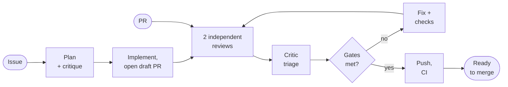

# paseo-dev-team

A ready-made [Paseo](https://github.com/getpaseo/paseo) agent team for taking GitHub work to a
merge-ready pull request. Each role runs on whichever agent and model you
assign it in Paseo; the repository ships a default preset (Claude and Codex). One command, `/deliver`, accepts an issue or a PR:

- **Issue:** reads it, settles the requirements, plans with a critic, implements
  in a separate worktree, opens a PR, then runs the review loop below.
- **PR:** two independent reviewers (by default on different agents) review a frozen
  candidate, an expert critic triages the findings, a developer fixes accepted
  ones, checks run, and the loop repeats until the PR meets the gates: score at
  or above the target (default 8/10 on the pr-review rubric), no open blockers,
  fixes independently verified, checks green.

You get a short report in the Paseo chat after every stage and one status
comment on the PR that ends with the final score and result. It never merges
or approves, and posts no other comments (apart from a link comment on the
issue in issue mode) unless you ask.

## How it works



An issue first gets a plan reviewed by the critic and an implementation in a
separate worktree, then a draft PR. From there issues and PRs share the same
loop: two reviewers on the same frozen candidate, critic triage, fixes and
checks, repeated until the score reaches the target with no open blockers. The
run stops and asks you when the issue is unclear, someone else already has a PR
for it, or it cannot push. Every stage ends with a short report in the Paseo
chat, and the status comment on the PR shows the current round. The
coordinator never merges; a human decides.

## What is included

| Path | Purpose |
|---|---|
| `skills/deliver` | The `/deliver` workflow (issue or PR → merge-ready PR). |
| `skills/scratch` | `/scratch <description>`: free-form task → draft issues in the right repositories → `/deliver` on each after you confirm. |
| `skills/pr-review` | PR review with a calibrated 0-10 score and inline findings. Also usable alone: `/pr-review <PR URL>`. |
| `skills/paseo-team` | Team roles and how to launch them in Paseo. |
| `profiles/team.json` | The six Paseo agent profiles the team uses. |
| `paseo/orchestration-prompt.md` | Team conventions added to Paseo's system prompt. |
| `skills/deliver/config/defaults.json` | Default settings; override them personally or per repository. |

## Optional: Agent board

The separate Agent board Paseo plugin (`asquad/paseo-agent-board`) shows the
agents of every repository under a workspace folder on one screen. When this
team is installed, it also follows `/deliver` runs (round, stage, score,
blocker) and can start them. It reads the run state file each run keeps in
`~/.paseo-dev-team/runs` (`skills/deliver/references/run-state.md`). The team
works the same without the plugin.

### Team

| Profile id | Role | Default preset |
|---|---|---|
| `team-coordinator` | Plans, delegates, integrates, owns Git | Claude Opus 5.5, medium |
| `team-developer` | Implements changes and tests | Claude Opus 5.5, high |
| `team-reviewer-a` | Independent reviewer | Codex GPT-6-Astra, high |
| `team-reviewer-b` | Independent reviewer | Claude Opus 5.5, high |
| `team-scout` | Bounded research | Claude Sonnet 5.5, medium |
| `team-expert` | Critic and expert advice | Claude Opus 5.5, max |

The skills refer to roles by profile id only and never assume a provider. To
use other agents, edit a profile in Paseo and pick any provider and model Paseo
supports (for example Copilot, OpenCode or Pi instead of Claude or Codex), with
that provider's mode and thinking options. No skill changes are needed, and
updates keep your choices. Two recommendations: put the two reviewers on
different agents or models, since independent opinions are the point of having
two, and give the coordinator an agent that can load skills (see Use).

## Requirements

- Paseo desktop app, started at least once.
- The agent providers your profiles use, signed in inside Paseo (Claude and
  Codex for the default preset).
- GitHub CLI signed in: `gh auth login` (the account that will push and comment).
- Git. Node.js 18+ is used if present; otherwise the installer runs on the
  runtime bundled with the Paseo app.

## Install

macOS, Linux:

```sh
git clone git@github.com:asquad/paseo-dev-team.git ~/src/paseo-dev-team
cd ~/src/paseo-dev-team
./install.sh
```

Windows PowerShell:

```powershell
git clone git@github.com:asquad/paseo-dev-team.git "$HOME\src\paseo-dev-team"
cd "$HOME\src\paseo-dev-team"
.\install.ps1
```

If PowerShell reports that running scripts is disabled, use
`powershell -ExecutionPolicy Bypass -File .\install.ps1` or
`node scripts\install.mjs` instead.

Keep the clone where it is: the installed skills are links into it. Put it
anywhere except inside a skills folder; the installer refuses to run from
there.

The installer:

1. Links `deliver`, `pr-review` and `paseo-team` into `~/.agents/skills` (the shared
   skills folder read by Codex and other agents) and `~/.claude/skills` (Claude
   Code). It never deletes folders,
   and only removes or re-points links it manages (its own, links into another
   paseo-dev-team clone, dangling links with the same name, and a legacy
   `pr-ready` link with `--replace-legacy`).
   An existing folder, or a link that leads elsewhere, with the same
   name is skipped unless you pass `--backup-conflicts`, which moves it to
   `~/.paseo-dev-team/backups/`. Links into a moved or another paseo-dev-team
   clone are re-pointed to this one.
2. Adds the team profiles to `~/.paseo/config.json` and writes the team block
   into Paseo's appended system prompt, leaving your other profiles and prompt
   text alone. The previous config is saved next to it as
   `config.json.bak-paseo-dev-team-<time>`.
3. Runs `paseo reload`.

Preview with `--dry-run`. All options: `./install.sh --help`.

**Update:** `git pull`, then run the installer again. Profile notes are
refreshed; your launch settings (provider, model, mode, thinking, feature
values) are kept unless you pass `--reset-profiles`.

**Uninstall:** run the installer with `--uninstall`. It removes only the links
that point into this clone, the team profiles and the team prompt block.

**Upgrading from pr-ready:** the old setup is a clone inside the skills
folder (`~/.agents/skills/pr-ready`), so do not pull and install there:

1. Commit and push any work in the old `~/.agents/skills/pr-ready` clone.
2. Clone the repository elsewhere, as in Install above.
3. From the new clone, run the installer once with `--replace-legacy
   --backup-conflicts`.

It moves the old `pr-ready`, `pr-review` and `paseo-team` folders to the
backups, removes the old `Mixed / …` (`shared-*`) profiles and the
`[Shared Paseo orchestration]` prompt block. Old `pr-ready-status` comments on
PRs are still recognized when resuming.

## Use

Start a Paseo agent with the **Team / Coordinator** profile in the repository you
work on, then:

```text
/deliver https://github.com/OWNER/REPO/issues/123
/deliver https://github.com/OWNER/REPO/pull/456
/deliver https://github.com/OWNER/REPO/pull/456 target 9, no-post
```

To start from a description instead of an issue, run `/scratch` from the
folder that holds all related repositories:

```text
/scratch Add CSV export to the reports API and a download button in the web app
```

It maps the work to repositories, extends matching open issues instead of
duplicating them, publishes new issues with the `draft` label and stops. Check
or edit them on GitHub, then reply `confirm` (or name the issues to confirm,
change or cancel). Scratch removes the label and starts `/deliver` on each
confirmed issue. Add `auto` to skip the stop.

The prefix follows the agent's skill syntax (`/deliver` in Claude Code,
`$deliver` in Codex). Plain words work too (`deliver #456`). If the
coordinator's agent does not load skills from these folders, ask it to read
`skills/deliver/SKILL.md` in this clone and follow it for the given URL.
Workers receive the paths of the skills they need, so they only need to read
files. You can add
run-specific instructions such as `no-post`, `local-only`, `no-push`,
`target 9`, `base staging` or `ready PR`.

What it does on GitHub with each launch:

- **PR:** pushes fixes to the PR branch and keeps one status comment on the PR.
- **Issue:** creates one new branch, pushes it, opens one PR (draft by default)
  with `Closes #N` (or `Refs #N` when it covers only part of the issue), keeps
  the status comment on that PR, posts one short link comment on the issue,
  and marks the PR ready once the gates pass. If an open PR for the issue
  already exists and you did not author it, or you cannot push to the
  repository, the run stops and asks. It does not push to an existing branch
  it did not create unless you tell it to deliver on that PR.

Merging, approving, enabling auto-merge, resolving threads and any other comment
always need your explicit request. If marking the PR ready would let
repository automation merge it without an approving review, the PR stays in
draft and the run asks. If the issue is unclear, the run stops and asks before
writing code.

A round uses about five agents (two reviewers, the critic, the developer, and
sometimes the scout) besides the coordinator, so a run costs noticeably more than
a single agent.

## Settings

Defaults are in `skills/deliver/config/defaults.json`. To change them for
yourself, create `~/.config/paseo-dev-team/config.json` (the same path under
`%USERPROFILE%` on Windows) with only the keys you want to change:

```json
{
  "scoreTarget": 8,
  "ci": { "skipChecks": ["^build-"] },
  "issue": { "prState": "ready" }
}
```

A repository can add `.paseo-dev-team.json` at its root for repository-wide
values, for example its base branch. It is read from the PR's base (in issue
mode, from the default branch). It can turn publication off (status comment,
issue link comment, ready PRs) but never on against your settings.
Instructions in the launch override both. All keys are described in
`skills/deliver/references/config.md`.

| Key | Default | Meaning |
|---|---|---|
| `statusComment` | `true` | Keep one status comment on the PR. |
| `scoreTarget` | `8` | Minimum final score (0-10). |
| `blocker` | `7` / `7` | Importance and confidence at which a finding blocks merge. |
| `maxActiveWorkers` | `2` | Parallel workers besides the coordinator. |
| `reviewLanguage` | `auto` | Language of GitHub text. |
| `ci.wait` | `required` | `required` (checks GitHub marks required; all checks if none are), `all` or `none`. |
| `ci.skipChecks` | `[]` | Regexes of checks not to wait for (reported as not awaited). |
| `followUpTests` | `affected` | Later rounds rerun only affected tests; `full` reruns all. |
| `issue.baseBranch` | `repo-default` | Base for new PRs. |
| `issue.prState` | `draft` | State of a newly opened PR. |
| `issue.markReadyWhenDone` | `true` | Mark the draft ready when the gates pass. |
| `issue.planCritique` | `true` | Critic reviews the plan before coding. |
| `issue.linkComment` | `true` | Comment on the issue with the PR link. |
| `workspace.title` | `Deliver {repo_name} #{number} ({summary})` | Paseo workspace name, e.g. `Deliver web-app #482 (Fix login redirect loop)`; also `{kind}`. |

## Troubleshooting

- **"profile team-… is missing":** run the installer again, then `paseo reload`.
- **Skill not found:** check that `~/.claude/skills/deliver` and
  `~/.agents/skills/deliver` exist and point into this clone, and restart the
  agent session. If your agent reads skills from another folder, link the three
  skills there or point the agent at `skills/deliver/SKILL.md`.
- **Installer cannot find a runtime on Linux:** install Node.js or set
  `PASEO_DEV_TEAM_NODE` to a node executable. The Paseo runtime paths probed on
  Linux (`/opt/Paseo/paseo`, `/usr/lib/paseo/paseo`) are guesses.

## License

MIT. See [LICENSE](LICENSE).
